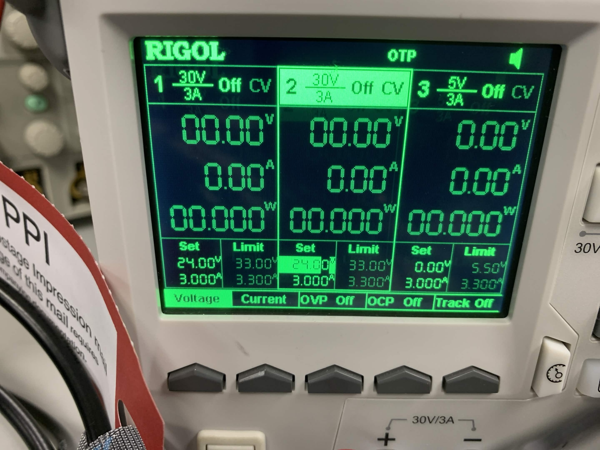
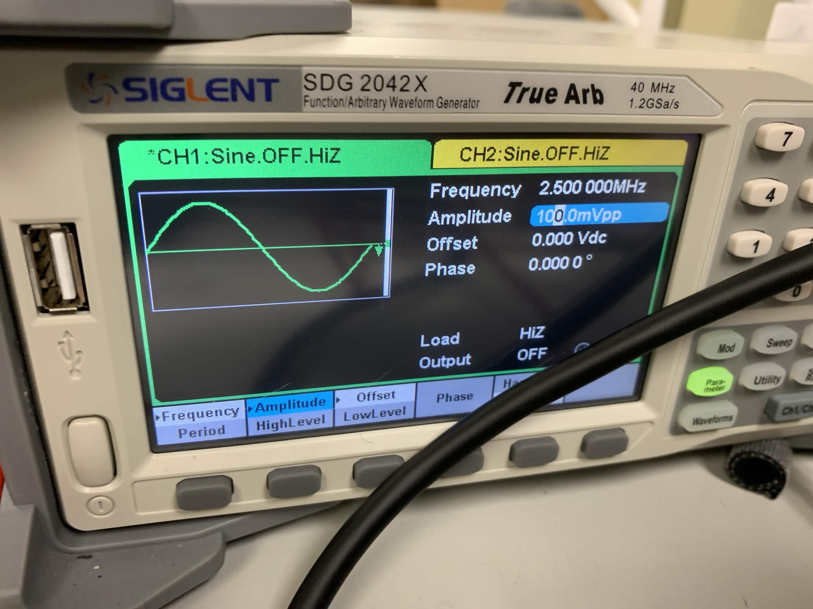
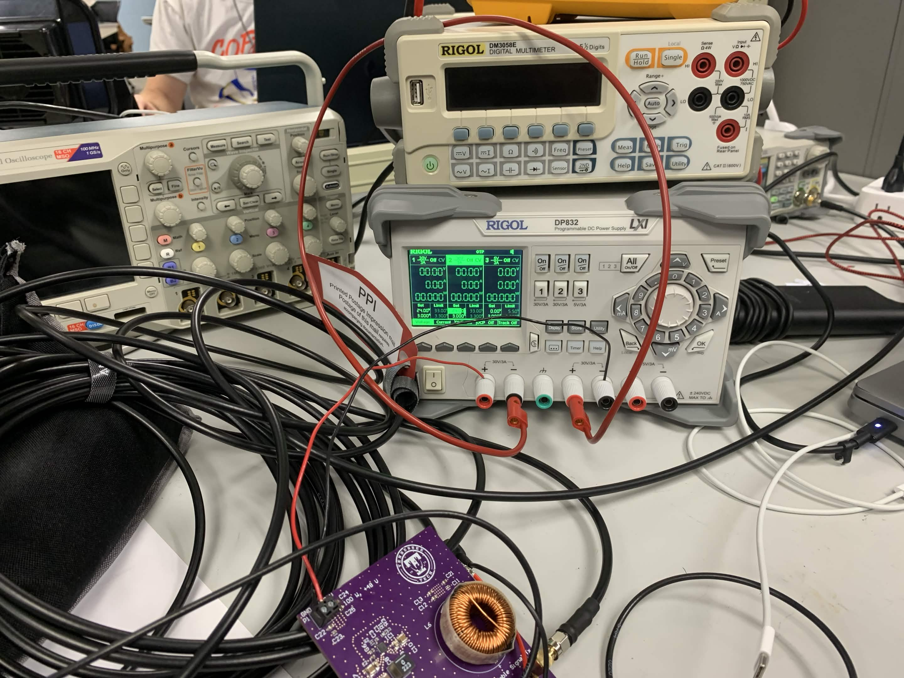

# Experimental Analysis: ComCaP System

# Experiments

## Experiment 1 – Signal Conditioning

### Purpose

The purpose of this experiment is to verify that the 2.5 MHz reference clock can successfully be conditioned by the receiver side signal conditioning circuitry.

The experiment will evaluate the following criteria:

- Adequate signal amplitude at the output of the ADA4899-1 amplifier.
- Successful conversion of the amplified analog clock into a digital signal by the ADCMP605.
- Consistent operation of the signal conditioning circuitry without clipping, unwanted oscillation, or missing transitions.

These criteria are important because the Si5345B requires a sufficiently clean input clock to generate the desired output frequencies and meet the system's jitter requirements.

### Procedure

**Equipment and project inventory:**
- Siglent SDG2042X waveform generator.
- Rigol DP832 DC power supply.
- Rigol DS1104 oscilloscope.
- Transmitter and receiver PCBs.
- Appropriate SMA/BNC cables, adapters, and test leads.

**Preparation and testing:**

1. Inspect the transmitter and receiver PCBs for assembly issues, incorrect component placement, and potential shorts.
2. Configure the Rigol DP832 to provide the required 48 V supply, as seen below. If using two channels in series, verify that the supply supports the intended series configuration and that the outputs are appropriately isolated. Set a conservative current limit before powering the circuit.
   
3. Configure the Siglent SDG2042X to generate a 2.5 MHz sine wave with an initial amplitude of 100 mVpp and 0 V offset, as seen below. Verify the generator's load setting to ensure the actual signal amplitude is correct.
    
4. Connect the waveform generator to the transmitter PCB's reference clock input.
5. Connect the transmitter and receiver PCBs through the intended 48 V power line connection.
6. Power the system and measure the reference signal at the receiver side Bias-T output using the Rigol DS1104.
7. Record the received signal's amplitude, frequency, and waveform.
8. Measure the output of the ADA4899-1 amplifier. Verify that the signal is sufficiently amplified and remains within the comparator's permitted input range.
9. Measure the ADCMP605 output to verify that the analog reference has been converted into a consistent digital clock signal.
10. Repeat the measurements after power cycling the system to evaluate startup consistency.

**Environmental conditions:** Conduct testing under stable laboratory conditions. Maintain consistent wiring, cable lengths, supply voltage, and instrument settings between trials.

Perform at least three independent trials, including a complete power cycle between trials. If multiple transmitter or receiver prototypes are available, repeat the experiment using different PCB combinations. Three trials provide an initial assessment of repeatability. Additional testing should be performed if significant variation occurs between trials.Save oscilloscope screenshots for the received reference, amplifier output, and comparator output. Record numerical measurements in a spreadsheet, with one row per trial.

#### Potential Biases and Error Sources

- **Generator amplitude inaccuracies:** The waveform generator's configured load impedance may cause the actual output amplitude to differ from the displayed value. Verify the signal with the oscilloscope.
- **Cable losses and impedance mismatches:** Use consistent cable lengths and appropriate terminations.
- **Oscilloscope measurement limitations:** The MSO2024 has limited bandwidth and sampling performance for very fast edges. Use it primarily to verify signal presence, frequency, and approximate amplitude.
- **Power supply variation:** Monitor the 48 V supply and current throughout testing.
- **Probe loading:** Use appropriate probe or coaxial connections to minimize loading effects on the circuit.

### Expected Results

| Measurement | Units | Measurement method | Expected Result |
|---|---|---|---|
| Generator frequency | MHz | Waveform generator setting and oscilloscope | 2.5 |
| Generator amplitude | mVpp | Oscilloscope | 100 |
| Received clock amplitude | mVpp | Oscilloscope | 60 |
| Received clock frequency | MHz | Oscilloscope | 2.5 |
| Amplifier output amplitude | Vpp | Oscilloscope | 1.5 |
| Comparator output voltage levels | V | Oscilloscope | 1.0 - 1.4 |
| Comparator output frequency | MHz | Oscilloscope | 2.5 |
| Supply voltage | V | DC power supply | 48 |
| Supply current | A | DC power supply | 3 |

### Actual Results

Although multiple Tx and Rx PCBs were planned to be constructed for experimentation, only one set of the boards was ultimately constructed due to time constraints upon receiving all required parts. While the initial Tx board passed physical inspection with no notable assembly issues or shorts detected, the initial Rx board required the use of a dead-bugged component (ADA4899-1) due to the incorrect, non-smd part version being ordered. Inspection of the Rx board revealed that this component had a short between one of its pins and the bridge to its ground pad which was not correctable without more precise soldering equipment. An attempt was made to replace this component with the correct smd part upon its arrival, however limitations in proper equipment to solder this part prevented proper seating of the IC and its pins. Consequently, an attempt to assemble a second Rx board was made in order to take advantage of fresh solder paste placed using a stencil for the board and this experiment was conducted multiple times using the two separate Rx boards fabricated for the ComCaP system. The second Rx board constructed revealed multiple defects upon inspection. Solder bridges were found shorting both the 12V and 3.3V supply rails to ground via capacitors C35 and C5 respectively. Additionally, the newly placed ADA4899-1 had a short between its positive and negative input terminals, inhibiting the intended feedback network. While the power supply shorts were solved by removing and reattaching components as needed, the available equipment ultimately proved insufficient to attach the ADA4899-1 IC correctly.

The Rigol DP832 was connected to the Tx PCB as seen below, utilizing two channels two provide a total of 48 V to the intended screw terminals. 
 
The reference signal provided by the Siglent SDG2042X waveform generator was confirmed by the Rigol DS1104 oscilloscope reading seen below.
 
The waveform for the received clock signal provided by the bias tee subsystem was confirmed via the oscilloscope as seen below.  
 

| Measurement | Units | Measurement method | Result |
|---|---|---|---|
| Generator frequency | MHz | Waveform generator setting and oscilloscope | 2.5 |
| Generator amplitude | mVpp | Oscilloscope | 100 |
| Received clock amplitude | mVpp | Oscilloscope | 85.6 |
| Received clock frequency | MHz | Oscilloscope | 2.52 |

### Interpretation and Conclusions

Without achieving successful operation of the ADA4899-1 OpAmp, we were unable to confirm operation of this subsystem at any capacity. If this board were to be assembled using a proper pick and place machine and a reflow oven, it is likely the connections would improve and the next section of the system would produce correct signals. The simulations previously run indicate that the system should function if all components were assembled properly.

---

## Experiment 2 – Si5345B Clock Generation and Output Verification

### Purpose

The purpose of this experiment is to verify that the Skyworks Si5345B successfully generates the required clock outputs from the recovered 2.5 MHz reference signal.

The primary criteria are:

- Successful configuration and startup of the Si5345B.
- Generation of a 25 MHz output clock.
- Generation of the required 2.5 MHz system clock output.
- Verification that the output signals have the expected frequency, voltage levels, and waveform characteristics.
- Consistent clock generation following repeated power cycles.

The outputs are configured for 3.3 V LVCMOS operation to simplify testing and integration. Successful operation is necessary to demonstrate that the clock generation subsystem can provide the required timing signal outputs for the ComCaP system.

### Procedure

**Equipment and project inventory:**
- Siglent SDG2042X waveform generator.
- Rigol DP832 DC power supply.
- Rigol DS1104 oscilloscope.
- Transmitter and receiver PCBs.
- STM32 microcontroller configuration firmware.
- Appropriate SMA/BNC cables, adapters, and test leads.

**Preparation and testing:**

1. Verify that the Si5345B is correctly installed and that its power supplies and required configuration pins are connected.
2. Verify that the STM32 microcontroller is programmed to load the Si5345B register configuration during startup.
3. Confirm that the Si5345B configuration specifies the intended 2.5 MHz and 25 MHz output frequencies and 3.3 V LVCMOS output signaling.
4. Generate and transmit the 2.5 MHz reference signal using the procedure described in Experiment 1.
5. Connect the 25 MHz output to the Rigol DS1104using an SMA to BNC cable assembly. Configure the oscilloscope for the appropriate input, DC coupling, and an appropriate vertical scale.
6. Measure the output frequency, voltage swing, duty cycle, and waveform stability.
7. Repeat the measurement for the 2.5 MHz output.
8. Power cycle the subsystem and verify that both outputs return successfully without requiring manual reconfiguration.

**Environmental conditions:** Maintain consistent supply voltages, wiring, and instrument settings. Allow the system to stabilize after startup before recording measurements.

Perform at least three independent startup trials. Each trial should include powering down the subsystem, restarting it, and verifying both output clocks.If multiple receiver PCB prototypes are available, test each prototype to evaluate consistency across hardware assemblies. Save oscilloscope screenshots of both output clocks. Record the measured values and whether the subsystem successfully initializes during each trial.

#### Potential Biases and Error Sources

- **Oscilloscope bandwidth:** The MSO2024's 200 MHz bandwidth limits its ability to accurately characterize fast clock edges.
- **Configuration errors:** Incorrect register settings may result in incorrect output frequencies or voltage levels. Verify the programmed configuration before testing.
- **Power supply variation:** Changes in supply voltage may affect output performance.
- **Measurement uncertainty:** Oscilloscope frequency and voltage measurements should be treated as verification of basic operation, not proof of jitter performance.

### Expected Results

| Measurement | Units | Measurement method |
|---|---|---|
| Reference input frequency | MHz | Oscilloscope |
| 25 MHz output frequency | MHz | Oscilloscope |
| 2.5 MHz output frequency | MHz | Oscilloscope |
| Output high voltage | V | Oscilloscope |
| Output low voltage | V | Oscilloscope |
| Peak-to-peak output voltage | Vpp | Oscilloscope |
| Duty cycle | % | Oscilloscope |
| Output period | ns / µs | Oscilloscope |
| Startup success | Pass/Fail | Observation |

### Actual Results

### Interpretation and Conclusions

---

## Experiment 3 – Clock Jitter and Relative Timing Characterization

### Purpose

The purpose of this experiment is to characterize the timing stability of the Si5345B generated clock outputs and evaluate whether the clock generation subsystem meets the project's jitter requirements.

The primary performance criteria are:

- Cycle-to-cycle jitter of the generated 25 MHz clock.
- Timing variation of the generated clock relative to the incoming 2.5 MHz reference.
- Relative timing variation between two identical ComCaP systems, if two prototypes are available.
- Comparison of measured timing variation against the project's 20–30 ps relative jitter target.

The customer's primary concern is reliable synchronization between ComCaP systems. Consequently, relative timing variation is particularly important.

### Procedure

**Equipment and project inventory:**
- Rigol DS1104 oscilloscope for preliminary jitter measurements.
- Rohde & Schwarz RT064 Oscilloscope for more accurate jitter characterization.
- Siglent SDG2042X waveform generator.
- Transmitter and receiver PCBs.
- STM32 microcontroller configuration firmware.
- Appropriate SMA/BNC cables, adapters, and test leads.
- A higher performance oscilloscope if available.

**Preparation and testing:**

1. Verify that the clock generation subsystem successfully passes Experiments 1 and 2.
2. Confirm that the Si5345B is locked to the incoming reference and that the 25 MHz output is stable.
3. Connect the 25 MHz output to the oscilloscope. Use the same output connection and loading conditions throughout the experiment.
4. Configure the oscilloscope to capture rising edges and use a consistent trigger threshold, preferably near 50% of the measured output voltage swing.
5. Configure the oscilloscope's jitter or timing measurement functions, if available.
6. Capture a sufficiently large sample of consecutive clock edges. The target should be at least 10,000 measured edges per acquisition when supported by the instrument.
7. Determine the period of each consecutive clock cycle and calculate cycle-to-cycle jitter using:

   \[
   J_{CC,n}=T_{n+1}-T_n
   \]

   Record the absolute magnitude where reporting maximum cycle-to-cycle deviation.
8. Repeat the acquisition to evaluate measurement repeatability.
9. For relative timing measurements within one system, simultaneously observe the 2.5 MHz reference and 25 MHz output using two oscilloscope channels. Compare the reference edge with a consistently selected corresponding 25 MHz edge. Since the output frequency is ten times the reference frequency, the edge relationship must be defined consistently.
10. If two ComCaP systems are available, distribute a common reference to both systems and measure their 25 MHz outputs simultaneously. Compare corresponding rising edges to determine relative timing variation.
11. Calculate the standard deviation, maximum, minimum, and range of the measured timing differences.
12. Compare the results with the project's specified jitter requirements.

**Environmental conditions:** Perform measurements in a stable laboratory environment. Maintain consistent cable lengths, oscilloscope settings, triggering conditions, and power supply conditions. Minimize electrical interference and avoid changing the measurement setup between acquisitions.

Perform at least three independent acquisitions for each jitter measurement condition. Each acquisition should contain at least 10,000 measured edges when supported by the instrument. If multiple ComCaP prototypes are available, perform relative timing measurements between different prototype combinations. This will help determine whether timing performance is consistent across systems. Three independent acquisitions are useful for assessing repeatability, but the number of edges and the statistical distribution should also be considered when evaluating jitter. Store the captured waveform data and measurement results in a spreadsheet. Include oscilloscope screenshots, acquisition settings, and instrument identification with each dataset.

The Rigol DS1104 can support preliminary verification of clock operation and waveform characteristics. However, its 200 MHz bandwidth and 1 GS/s maximum sampling rate do not establish that it can reliably verify the project's picosecond level jitter requirements. A higher performance measurement instrument should therefore be used for final jitter acceptance testing, such as the Rohde & Schwarz RT064 Oscilloscope available to Siemens Healthineers.

#### Potential Biases and Error Sources

- **Oscilloscope timebase jitter:** The instrument's internal timebase may contribute timing uncertainty. Its jitter must be substantially lower than the expected measurement to avoid dominating the result.
- **Sampling rate:** Insufficient sampling resolution can affect edge interpolation and timing measurements. Higher sampling rates generally improve the available timing information, but do not guarantee accurate picosecond measurements.
- **Analog bandwidth:** Insufficient bandwidth can distort clock edges and affect threshold crossing measurements.
- **Trigger noise:** Trigger uncertainty can introduce additional timing variation. Use consistent trigger settings and thresholds.
- **Channel-to-channel skew:** Relative measurements using two channels may be affected by differences in channel delay and cable length.
- **Signal noise:** Electrical noise on the clock edges can shift the measured threshold crossing time.
- **Measurement sample size:** Too few measured edges may produce misleading statistical results. Use at least 10,000 edges per acquisition where possible.
- **Instrument limitations:** The existing MSO2024 is appropriate for preliminary clock verification but should not be considered sufficient evidence of sub picosecond jitter or a 20–30 ps relative jitter result without a documented measurement floor.

A higher performance oscilloscope with approximately 1–2 GHz analog bandwidth, 4 GS/s or greater sampling capability, and documented low timing jitter would be preferable for this experiment.

### Expected Results

| Measurement | Units | Measurement method |
|---|---|---|
| Clock frequency | MHz | Oscilloscope |
| Clock period | ns | Oscilloscope |
| Individual cycle periods | ns | Edge-to-edge timing measurements |
| Cycle-to-cycle jitter | ps | Difference between consecutive periods |
| Relative timing difference | ps | Simultaneous channel timing measurement |
| RMS/standard deviation of timing variation | ps | Statistical analysis |
| Maximum timing deviation | ps | Statistical analysis |
| Minimum timing deviation | ps | Statistical analysis |
| Peak-to-peak timing variation | ps | Maximum minus minimum |
| Number of measured edges | Count | Acquisition settings |

### Actual Results

### Interpretation and Conclusions

---

## Experiment 4 - Clock and Communication Transmission Characteristics

### Purpose

The purpose of this experiment is to verify the transmission characteristcs of both of the cables at all the required lengths for both the $2.5\ MHz$ clock and the $200\ kHz$ communications signals. The communications signal needs to be able to be read by the recieving board, and the clock signal needs to transmit at least half of its peak voltage.

### Procedure

**Equipment and project inventory:**
- Reciever PCB
- Keysight E5063A ENA Vector Network Analyzer (VNA)
- Belden 7810A coaxial cables at appropriate lengths
- Belden 50021L twisted pair cables at appropriate lengths
- Appropriate SMA/BNC cables, adapters, and test leads

**Preparation and testing:**
1. Turn on the VNA and leave it for 30 minutes to warm up
2. Connect the reciever board clock output to port 2 of the VNA
3. Connect the cable from the input of the reciever board to port 1 of the VNA
4. Sweep $2.5\ MHz\ \pm 5\%$  and record the S-parameters
5. Repeat steps 2-4 with all available cables for the clock
6. Change the connection from the clock to the communications output
7. Sweep $200\ kHz\ \pm 5\%$ and record the S-parameters
8. Repeat step 7 for all available cables

### Data Collection

| Measurement | Units | Measurement method |
|---|---|---|
| Clock $S_{11}$ | dB | VNA |
| Clock $S_{12}$ | dB | VNA |
| Clock $S_{21}$ | dB | VNA |
| Clock $S_{22}$ | dB | VNA |
| Communications $S_{11}$ | dB | VNA |
| Communications $S_{12}$ | dB | VNA |
| Communications $S_{21}$ | dB | VNA |
| Communications $S_{22}$ | dB | VNA |

Load the S-parameter data into MATLAB for analysis and display.

### Trials

Perform this test before testing anything else regarding the cables in case they are damaged in subsequent DC voltage and current testing.

### Potential Biases and Error Sources

- **Output Measurement Cable** Since the output is being measured at the end of the bias tee, the cables that are being used may introduce noise and impedance mismatching. This will cause the S-parameters to record greater losses than will be actually experienced in the circuit.
- **Independent Testing** Since the clock and communications frequencies are tested separately, there may be some interferences in normal operation that are not being tested.

---

## Experiment 5 - Cable DC Voltage and Current Verification

### Purpose

The purpose of this experiment is to verify the cables ability to handle $50\ V$ at $2\ A$. The cable itself cannot exceed it's rated safe operating temperature.

### Procedure

**Equipment and project inventory:**
- Belden 7810A coaxial cables at appropriate lengths
- Belden 50021L twisted pair cables at appropriate lengths
- Multimeter
- Thermometer Gun
- Stopwatch
- Tape Measure
- Breadboard with $25\ \Omega$ resistance
- Appropriate SMA/BNC cables, adapters, and test leads

**Preparation and testing:**
1. Use a multimeter to verify the end resistance is $25\ \Omega$
2. Use a tape measure to mark along the cable at 1 m intervals
3. Connect one end of the cable to a voltage source and the other to the resistor
4. Connect a multimeter in series with the cable to measure current
5. Turn on the voltage source and verify $2\ A$ is running thorough the cable
6. Use the termperature gun to measure the temperature of the cable at every meter along it
7. Repeat step 6 at 5 minute intervals for the first hour and 15 minute intervals for the following two hours
8. Repeat steps 2-7 for all available cables

### Data Collection

| Measurement | Units | Measurement method |
|---|---|---|
| Temperature | $^\circ C$ | Temperature Gun |
| Time | s | Stopwatch |
| DC Current | A | Multimeter |
| Load Resistance | $\Omega$ | Multimeter |
| Length along Cable | m | Tape Measure |

Record the data using excel. Load the data into MATLAB for analysis and display.

### Trials

Perform multiple measurement calculations along the cable to minimize variations due to contacts with other materials or uneven air temperature

Be sure to shut off the circuit in the event of any changes becoming necessary. 50 V DC is extremely dangerous and should not be taken lightly

### Potential Biases and Error Sources

- **Ambient Temperature** The temperature of the room will have an impact on the overall temperature of the cable, so it must be taken into account when the measurements are taken.
- **Body Temperature** While the cable is being handled for measurements, body temperature may change the temperature of the cable
- **Circuit Downtime** Since the voltage is so high, the circuit may need to be shut down if measurements are not able to be taken. In those instances, the cable will be cooling while the circuit is off
- **External Resistance** The multimeter and the resistor setup may introduce additional resistance or unwanted behaviors. Espeically from the multiple resistances in parallel.
- **Temperature Gun Inconsistencies** The temperature gun itself may introduce some variations in the temperature data

## Experiment 6 - IC Power: Buck Converter and LDO Testing

### Purpose

The purpose of this experiment is to verify the proper output voltages of the power converters to ensure that each IC that uses a lower voltage than 48 V is satisfied. The voltages being produced are 12 V from the buck converter, 5 V, 3.3 V, and 1.8 V that are stepped down from the buck converter by an LDO. The voltages must supply a voltage that is within the input range of all ICs requiring voltage lower than 48 V.

### Procedure

**Equipment and project inventory:**
- Reciever PCB
- Transmitter PCB
- LT80602
- MAX6793
- MAX6795
- Fluke 15B+ Digital Multimeter (DMM)
- Rigol DP832 DC power supply

**Preparation and testing:**
1. Connect Tx board to benchtop supply.
2. Configure the Rigol DP832 to provide the required 48 V supply. If using two channels in series, verify that the supply supports the intended series configuration and that the outputs are appropriately isolated. The series setting is typically 24 V for both outputs 1 and 2. Set a conservative current limit before powering the circuit about 300 mA. To configure power supply, connect the positive and negative terminals of two adjacent output channels together, and connect the ground of the open terminal output to the ground of the board. Connect the open positive voltage terminal to the positive terminal of the board.
3. Connect the 10 m cable from output of the Tx board to the input of the Rx board.
4. Turn on the power supply.
5. Probe the output of the power plane of the buck converter (LT80602) on the Tx board. Connect the ground probe to the nearest ground via.
6. Probe the output of the power plane of the buck converter (LT80602) on the Rx board. Connect the ground probe to the nearest ground via.
7. Probe the output of the first power plane of the first LDO (MAX6793) on the Rx board. Connect the ground probe to the nearest ground via.
8. Probe the output of the second power plane of the first LDO (MAX6793) on the Rx board. Connect the ground probe to the nearest ground via.
9. Probe the output of power plane of the second LDO (MAX6795) on the Rx board. Connect the ground probe to the nearest ground via.

**Environmental conditions:** Conduct testing under stable laboratory conditions. Maintain consistent wiring, cable lengths, supply voltage, and instrument settings between trials.

<!-- Perform at least three independent trials, including a complete power cycle between trials. If multiple transmitter or receiver prototypes are available, repeat the experiment using different PCB combinations. Three trials provide an initial assessment of repeatability. Additional testing should be performed if significant variation occurs between trials. -->

#### Potential Biases and Error Sources

- **Hand Assembly** The passive components were assembled by hand on the boards used to test. This could have potentially caused some inconsistent connections on various components causing the voltage to deviate slightly from the expected result. This could cause issues for setting the proper voltages.
- **Long Return Current Loop** If a ground connection is probed that is located far from the measured power rail, the measured voltage will be skewed and potentially recorded incorrectly.

### Expected Results

| Measurement | Units | Measurement method |
|---|---|---|
| 12 V Rail of LT80602 (Tx) | V | DMM |
| 12 V Rail of LT80602 (Rx) | V | DMM |
| 5 V Rail of MAX6793 (Rx) | V | DMM |
| 1.8 V Rail of MAX6793 (Rx) | V | DMM |
| 3.3 V Rail of MAX6795(Rx) | V | DMM |

Record measurements of voltage rails with multimeter at the output of the LDOs and Buck Converter. Perform this test when powering up the boards for the first time after assembly to ensure that all voltage rails are within specifications for input voltage of all relevant ICs. Expected results are that all Bucks and LDOs output voltages detailed in the specifications.

### Actual Results

Although multiple Tx and Rx PCBs were planned to be constructed for experimentation, only one set of the boards was ultimately constructed due to time constraints upon receiving all required parts. While the initial Tx board passed physical inspection with no notable assembly issues or shorts detected, the initial Rx board required the use of a dead-bugged component (ADA4899-1) due to the incorrect, non-smd part version being ordered. Inspection of the Rx board revealed that this component had a short between one of its pins and the bridge to its ground pad which was not correctable without more precise soldering equipment. An attempt was made to replace this component with the correct smd part upon its arrival, however limitations in proper equipment to solder this part prevented proper seating of the IC and its pins. Consequently, an attempt to assemble a second Rx board was made in order to take advantage of fresh solder paste placed using a stencil for the board and this experiment was conducted multiple times using the two separate Rx boards fabricated for the ComCaP system. The second Rx board constructed revealed multiple defects upon inspection. Solder bridges were found shorting both the 12V and 3.3V supply rails to ground via capacitors C35 and C5 respectively. After the components were removed and replaced, the outputs of the power converters became closer to the expected values, but they still varied a fairly large amount compared to the first board tested.

### Interpretation and Conclusions

| Measurement Rx Board 1 | Expected (V) | Actual (V) |
|---|---|---|
| 12 V Rail of LT80602 (Tx) | 12 | 11.99 |
| 12 V Rail of LT80602 (Rx) | 12 | 11.99 |
| 5 V Rail of MAX6793 (Rx) | 5 | 4.99 |
| 1.8 V Rail of MAX6793 (Rx) | 1.8 | 1.78 |
| 3.3 V Rail of MAX6795(Rx) | 3.3 | 3.33 |

The results from the first board assembled provided results well within specifications required for all ICs that required voltages from these converters. However, on the second board, the voltages produced varied more significantly. The 12 V and 5 V rails provided about the same results as shown in the table above, but the 1.8 V and 3.3 V rails were out of spec for the devices they powered. However, despite this variation, the components still functioned normally as was observed in the MCU being able to be programmed. The functionality of the PLL, comparator, and op-amp ICs could not be confirmed due to faulty solder connections.

Experiment - Scheme Determination
 Purpose and Justification
Determine which modulation scheme has the most effective communication.

3.2 Hypothesis / Expected Results
The 8-PSK Modulation scheme should provide the highest bitrate, with qpsk having a lower bitrate, and bpsk having the lowest bitrate.

3.3 Procedure
Environmental Conditions:

Standard indoor lab conditions, room temperature, normal lighting.
Preparation Steps:

Connect the CN1 Terminals of both boards together for the PLM connection, and
Externally provide a supply voltage of 12 V from a DC Power Supply to each board.
Procedure Steps:

Start the listening modem with the command py blast.py COM12 --listen
In a separate terminal, start the sending modem with the command py blast.py COM11 --size 200 --count 260 --mod [INSERT MODULATION SCHEME HERE] --layer dl 
Check the listening modem's terminal is receiving packet indications
Results will be returned in the terminal
3.4 Data Collection Plan
The command line results will be in the form

[ <Timestamp>s] sent=xxx ok=yyy err=a nak=b timeout=c   d.dd frames/s  goodput=  e.ee kbps where

xxx : Packets attempted to be sent to the board from the computer
yyy : The modem confirmed it received the packet from the computer
a   : The modem sent back an error packet
b   : The modem rejected the packet due to corruption or bad checksum
c   : The modem did not send a response packet
d.dd: Number of frames sent per second
e.ee: The bitrate of the successful packets
3.5 Trials
Number of trials: N ~= 1000 per category.
Justification: This number of trials is trivial to perform and should provide enough specificity to acheive a significance level of 0.05
3.6 Potential Biases and Mitigation
Potential Bias / Source of Error	Mitigation Strategy
Inability to start the listener and sender simultaneously	Both terminals are side-by-side when activated, and the listener is started first
Limited packet length	Maximize packet length programatically
Imprecise connections	Connections shall be secured with screw terminals at the proper tightness with
3.7 Actual Results
Raw Data:

B-PSK: [ 395.3s] sent=1006 ok=1006 err=0 nak=0 timeout=0 2.55 frames/s goodput= 4.07 kbps

Q-PSK: [ 341.5s] sent=1005 ok=1003 err=0 nak=1 timeout=1 2.94 frames/s goodput= 4.70 kbps

8-PSK: [ 346.1s] sent=1009 ok=1004 err=0 nak=2 timeout=3 2.90 frames/s goodput= 4.64 kbps

Full data attached in Experiment_A.txt

3.8 Rejection/Failed Rejection Against Null Hypotheses
Test 1: 8PSK > QPSK $ H_0 :\ \mu_{8PSK} \le \mu_{QPSK}$ $ H_1 :\ \mu_{8PSK} \gt \mu_{QPSK}$ $ \mu_{8PSK} - \mu_{QPSK} = -0.06\ kbps$ Critical t value: 1.646 $ t_{8PSK-QPSK}(1000) = -0.76 $ $-0.76 < 1.646 $ thus we fail to reject the null hypothesis.

Test 2: QPSK > BPSK $ H_0 :\ \mu_{QPSK} \le \mu_{BPSK}$ $ H_1 :\ \mu_{QPSK} \gt \mu_{BPSK}$ Critical t value: 1.646 $ t_{QPSK-BPSK}(1000) = 8.92 $ $8.92 < 1.646 $ thus we reject the null hypothesis.

3.9 Interpretation and Conclusions
8PSK and QPSK are similar in bitrate while BPSK has the lowest bitrate. This is contrary to the hypothesis, which assumed that 8PSK would have the higher bitrate. This is likely due to most of the packet transmission time being propagation. This could also be

3.10 Components Used / Damaged / Replaced
The following components were used in this experiment

STM32 NUCLEO-F401RE
X-NUCLEO-PLM01A1
2x Mini USB-B Cables
The following components was replaced

STM32 NUCLEO-L476RG
3. Experiment B: Effect of Bias Tee on Packet Transmission Success
3.1 Purpose and Justification
Verify that the Bias Tee and Transmission Line has little effect on the Packet Loss Rate (the sum of the Error, Timeout, and Negative Acknowledgement rates).

3.2 Hypothesis / Expected Results
The addition of the bias tee has no statistically significant effect on the Packet Loss Rate of the Power Line Communication Modem's connection.

3.3 Procedure
Environmental Conditions:

Standard indoor lab conditions, room temperature, normal lighting.
Preparation Steps: For Control Group

Connect the CN1 Terminals of both boards together for the PLM connection,
externally provide a supply voltage of 12 V from a DC Power Supply
Connect the Nucleo boards to the controlling computer via Mini USB-B
For Test Group

Connect the CN1 Terminal on the boards to their respective "PLM" ports on the RX and TX PCBs.
Connect the 12V from the expansion board to the 12V on the PCBs.
Connect a Waveform Generator signal configured at 2.5MHz to the PCB at the CLK Coaxial port on the TX PCB
Connect the DC Electronic Load configured at 100W to the 48V output on the RX PCB
Connect a 48V DC Power Supply to the 48V input on the TX PCB
Connect the Nucleo boards to the controlling computer via Mini USB-B
Turn on the Waveform Generator
Turn on the DC Power Supply
Turn on the DC Electronic Load
Procedure Steps:

Start the listening modem with the command py blast.py COM12 --listen
In a separate terminal, start the sending modem with the command py blast.py COM11 --size 200 --count 260 --mod [INSERT MODULATION SCHEME HERE] --layer dl 
Check the listening modem's terminal is receiving packet indications
Results will be returned in the terminal
3.4 Data Collection Plan
The command line results will be in the form

[ <Timestamp>s] sent=xxx ok=yyy err=a nak=b timeout=c   d.dd frames/s  goodput=  e.ee kbps where

xxx : Packets attempted to be sent to the board from the computer
yyy : The modem confirmed it received the packet from the computer
a   : The modem sent back an error packet
b   : The modem rejected the packet due to corruption or bad checksum
c   : The modem did not send a response packet
d.dd: Number of frames sent per second
e.ee: The bitrate of the successful packets
3.5 Trials
Number of trials: N = 1000 per category.
Justification: The variety of categories ensures full coverage of the motion system; 10 trials per category provides meaningful mean and max values.
3.6 Potential Biases and Mitigation
Potential Bias / Source of Error	Mitigation Strategy
Inability to start the listener and sender simultaneously	Both terminals are side-by-side when activated, and the listener is started first
Limited packet length	Maximize packet length programatically
Imprecise connections	Connections shall be secured with screw terminals at the proper tightness with
Potential EM Interference in the cable	The cable is ideal for preventing EMI, and the ST7580 has a PLL on-chip
3.7 Actual Results
Raw Data:

With Bias Tee: [ 343.9s] sent=1007 ok=1007 err=0 nak=0 timeout=0 2.93 frames/s goodput= 4.69 kbps

Without Bias Tee: [ 343.5s] sent=1009 ok=1007 err=0 nak=1 timeout=1 2.93 frames/s goodput= 4.69 kbps

Full terminal result attached in Experiment_B.txt

3.8 Rejection/Failed Rejection Against Null Hypotheses
Test 1: With Bias Tee = Without Bias Tee $ H_0 :\ \mu_{with} \ne \mu_{without}$ $ H_1 :\ \mu_{with} = \mu_{without}$ $ \mu_{with} - \mu_{without} = -0.06\ kbps$ Critical t value: 
±
1.967
±1.967 $ t_{with-without}(1000) = -0.68 $ $-0.68 < 1.646 $ thus we reject the null hypothesis.

3.9 Interpretation and Conclusions
This system has proven that it functions virtually identically within and without the Bias Tee system. The filtering on the Bias Tee passes the PLM's data signal without enough interference to affect functioning.

3.10 Components Used / Damaged / Replaced
The following components were used in this experiment

STM32 NUCLEO-F401RE
X-NUCLEO-PLM01A1
2x Mini USB-B Cables
The following components was replaced

STM32 NUCLEO-L476RG

## Summary and Findings

# Documented and Tracked Components

| Quantity | Manufacturer                      | Manufacturer Part Number | Distributor           | Distributor Part Number     | Description                                              | Price for 1 | Price for All | Storage Location | Condition | Link                                                                                                                          |
| -------- | --------------------------------- | ------------------------ | --------------------- | --------------------------- | -------------------------------------------------------- | ----------- | ------------- | ---------------- | --------- | ----------------------------------------------------------------------------------------------------------------------------- |
| 2        | Tensility International Corp      | 54-00166                 | DigiKey               | 839-54-00166-ND             | CONN JACK R/A PCB 5.5X2.1MM                              | $0.65       | $1.30         | On Board         | Used      | [Link](https://www.digikey.com/en/products/detail/tensility-international-corp/54-00166/10459294)                             |
| 1        | Skyworks                          | Si5345                   | DigiKey               | SI5345B-D-GM                | PLL Chip                                                 | $37.99      | $37.99        | On Board         | Used      | [Link](https://www.digikey.com/en/products/detail/skyworks-solutions-inc/SI5345B-D-GM/6166371)                                |
| 1        | TXC Corp.                         | 7M48072002               | DigiKey               | 887-2480-1-ND               | 48 MHz Crystal Oscillator                                | $1.00       | $1.00         | On Board         | Used      | [Link](https://www.digikey.com/en/products/detail/txc-corporation/7M48072002/4918837)                                         |
| 1        | Analog Devices Inc.               | ADA4899-1                | DigiKey               | ADA4899-1YRDZ-R7            | OpAmp                                                    | $6.94       | $6.94         | Never Received   | Unused    | [Link](https://www.digikey.com/en/products/detail/analog-devices-inc/ADA4899-1YRDZ-R7/1199772)                                |
| 1        | Analog Devices Inc.               | ADCMP605                 | DigiKey               | ADCMP605BCPZ-R7             | LVDS out Comparator                                      | $8.46       | $8.46         | On Board         | Used      | [Link](https://www.digikey.com/en/products/detail/analog-devices-inc/ADCMP605BCPZ-R7/1246082)                                 |
| 1        | STMicroelectronics                | STM32G030K8T6            | DigiKey               | STM32G030K8T6               | Microcontroller                                          | $2.21       | $2.21         | On Board         | Used      | [Link](https://www.digikey.com/en/products/detail/stmicroelectronics/stm32g030k8t6/10326689)                                  |
| 10       | Samsung Electro-Mechanics         | CL05A104KA5NNNC          | DigiKey               | 1276-1043-1-ND              | 0.1 µF ±10% 25V Ceramic Capacitor                        | $0.019      | $0.19         | On Board         | Used      | [Link](https://www.digikey.com/en/products/detail/samsung-electro-mechanics-america-inc/CL05A104KA5NNNC/3889129)              |
| 2        | KEMET                             | C0603C105K4RACTU         | DigiKey               | 399-C0603C105K4RACTUCT-ND   | 1 µF ±10% 16V Ceramic Capacitor                          | $0.13       | $0.26         | On Board         | Used      | [Link](https://www.digikey.com/en/products/detail/kemet/C0603C105K4RAC7867/3471570)                                           |
| 1        | Wurth Elektronik                  | 61300411121              | DigiKey               | 732-5317-ND                 | CONN HEADER VERT 4POS 2.54MM                             | $0.18       | $0.18         | On Board         | Used      | [Link](https://www.digikey.com/en/products/detail/w%C3%BCrth-elektronik/61300411121/4846827)                                  |
| 6        | Vishay Dale                       | CRCW040210K0FKEE         | DigiKey               | 541-2954-1-ND               | 10 kOhms ±1% 0.063W, 1/16W Chip Resistor                 | $0.32       | $0.32         | Never Received   | Unused    | [Link](https://www.digikey.com/en/products/detail/vishay-dale/CRCW040210K0FKEE/6073597)                                       |
| 2        | Vishay Dale                       | CRCW04024K70FKED         | DigiKey               | 541-4.70KLCT-ND             | 4.7 kOhms ±1% 0.063W, 1/16W Chip Resistor                | $0.10       | $0.20         | On Board         | Used      | [Link](https://www.digikey.com/en/products/detail/vishay-dale/CRCW04024K70FKED/1183199)                                       |
| 2        | YAGEO                             | RC0603FR-10100RL         | DigiKey               | 13-RC0603FR-10100RLCT-ND    | 100 Ohms ±1% 0.1W, 1/10W Chip Resistor                   | $0.10       | $0.20         | On Board         | Used      | [Link](https://www.digikey.com/en/products/detail/yageo/RC0603FR-10100RL/12756390)                                            |
| 1        | YAGEO                             | RC0402FR-0714KL          | DigiKey               | 311-14.0KLRCT-ND            | 14 kOhms ±1% 0.063W, 1/16W Chip Resistor                 | $0.11       | $0.11         | On Board         | Used      | [Link](https://www.digikey.com/en/products/detail/yageo/RC0402FR-0714KL/726540)                                               |
| 1        | YAGEO                             | RC0603FR-131KL           | DigiKey               | 13-RC0603FR-131KLCT-ND      | 1 kOhms ±1% 0.1W, 1/10W Chip Resistor                    | $0.10       | $0.10         | On Board         | Used      | [Link](https://www.digikey.com/en/products/detail/yageo/RC0603FR-131KL/12756423)                                              |
| 1        | YAGEO                             | RC0402FR-07324KL         | DigiKey               | YAG3117CT-ND                | 324 kOhms ±1% 0.063W, 1/16W Chip Resistor                | $0.10       | $0.10         | On Board         | Used      | [Link](https://www.digikey.com/en/products/detail/yageo/RC0402FR-07324KL/5281982)                                             |
| 10       | Pomoma Electronics                | 72971                    | DigiKey               | 501-2409-ND                 | SMA through hole                                         | $10.08      | $20.16        | On Board         | Used      | [Link](https://www.digikey.com/en/products/detail/pomona-electronics/72971/1825153)                                           |
| 10       | KEMET                             | C1206C684K1RACTU         | DigiKey               | 399-15137-1-ND              | 0.68 µF Capacitor                                        | $0.31       | $3.10         | On Board         | Used      | [Link](https://www.digikey.com/en/products/detail/kemet/C1206C684K1RACTU/7382252)                                             |
| 10       | KYOCERA AVX                       | 06035A300JAT2A           | DigiKey               | 478-7917-1-ND               | 30 pF Capacitor                                          | $0.051      | $0.51         | On Board         | Used      | [Link](https://www.digikey.com/en/products/detail/kyocera-avx/06035A300JAT2A/1599777)                                         |
| 10       | PANASONIC                         | CC0402KRX7R9BB272        | DigiKey               | 311-1033-1-ND               | 2700 pF Capacitor                                        | $0.036      | $0.36         | On Board         | Used      | [Link](https://www.digikey.com/en/products/detail/yageo/CC0402KRX7R9BB272/302767)                                             |
| 10       | Murata Electronics                | GRM1885C1H302JA01D       | DigiKey               | 490-6384-1-ND               | 3000 pF Capacitor                                        | $0.058      | $0.58         | On Board         | Used      | [Link](https://www.digikey.com/en/products/detail/murata-electronics/GRM1885C1H302JA01D/2611152)                              |
| 10       | Murata Electronics                | GRM155R71H332KA01D       | DigiKey               | 490-3248-1-ND               | 3300 pF Capacitor                                        | $0.02       | $0.20         | On Board         | Used      | [Link](https://www.digikey.com/en/products/detail/murata-electronics/GRM155R71H332KA01D/702513)                               |
| 10       | Murata Electronics                | GRM1885C1H512JA01D       | DigiKey               | 490-GRM1885C1H512JA01DCT-ND | 5100 pF Capacitor                                        | $0.071      | $0.71         | On Board         | Used      | [Link](https://www.digikey.com/en/products/detail/bourns-inc/2300LL-102-H-RC/725892)                                          |
| 15       | TDK                               | C2012X7S2A105K125AB      | DigiKey               | 445-5205-1-ND               | 1 uF Capacitor                                           | $0.269      | $4.035        | On Board         | Used      | [Link](https://www.digikey.com/en/products/detail/tdk/C2012X7S2A105K125AB/2116321)                                            |
| 10       | Bourns Inc.                       | 2300LL-102-H-RC          | DigiKey               | 2300LL-102-H-RC-ND          | 1 mH Inductor                                            | $3.884      | $38.84        | On Board         | Used      | [Link](https://www.digikey.com/en/products/detail/bourns-inc/2300LL-102-H-RC/725892)                                          |
| 10       | TDK                               | NLV32T-180J-EF           | DigiKey               | 445-16560-1-ND              | 18 uH Inductor                                           | $0.158      | $1.58         | On Board         | Used      | [Link](https://www.digikey.com/en/products/detail/tdk/NLV32T-180J-EF/4741478)                                                 |
| 10       | TDK                               | NLV25T-390J-EF           | DigiKey               | 445-16478-1-ND              | 39 uH Inductor                                           | $0.149      | $1.49         | On Board         | Used      | [Link](https://www.digikey.com/en/products/detail/tdk/NLV25T-390J-EF/4741361)                                                 |
| 10       | Bourns Inc.                       | SRR7045-101M             | DigiKey               | 118-SRR7045-101MCT-ND       | 0.1 mH Inductor                                          | $0.557      | $5.57         | On Board         | Used      | [Link](https://www.digikey.com/en/products/detail/bourns-inc/SRR7045-101M/1970429)                                            |
| 10       | Yageo Group                       | RC0402JR-0750RL          | DigiKey               | 13-RC0402JR-0750RLCT-ND     | 50 Ohm Resistor                                          | $0.02       | $0.20         | On Board         | Used      | [Link](https://www.digikey.com/en/products/detail/yageo/RC0402JR-0750RL/5917787)                                              |
| 3        | Murata Electronics                | GRM188Z71A106KA73D       | DigiKey               | 490-GRM188Z71A106KA73DCT-ND | 10 uf Capacitor                                          | $0.25       | $0.75         | On Board         | Used      | [Link](https://www.digikey.com/en/products/detail/murata-electronics/GRM188Z71A106KA73D/13693280)                             |
| 4        | Murata Electronics                | GRM32EC72A106KE05L       | DigiKey               | 490-16266-1-ND              | 10 uf                                                    | $1.12       | $4.48         | On Board         | Used      | [Link](https://www.digikey.com/en/products/detail/murata-electronics/GRM32EC72A106KE05L/7319356)                              |
| 5        | Murata Electronics                | GRM188Z71A106KA73D       | DigiKey               | 490-GRM188Z71A106KA73DCT-ND | 10 uf                                                    | $0.25       | $1.25         | On Board         | Used      | [Link](https://www.digikey.com/en/products/detail/murata-electronics/GRM188Z71A106KA73D/13693280)                             |
| 3        | Infineon Technologies             | BSP316P                  | DigiKey               | BSP316PH6327XTSA1CT-ND      | N/A                                                      | $1.07       | $3.21         | On Board         | Used      | [Link](https://www.digikey.com/en/products/detail/infineon-technologies/BSP316PH6327XTSA1/5409992)                            |
| 4        | YAGEO                             | RC0402FR-07100KL         | DigiKey               | 311-100KLRCT-ND             | 100 kΩ                                                   | $0.10       | $0.40         | Never Received   | Unused    | [Link](https://www.digikey.com/en/products/detail/yageo/RC0402FR-07100KL/729473)                                              |
| 1        | YAGEO                             | RC0402FR-071KL           | DigiKey               | 311-1.00KLRCT-ND            | 1 kΩ                                                     | $0.10       | $0.10         | On Board         | Used      | [Link](https://www.digikey.com/en/products/detail/yageo/RC0402FR-071KL/729460)                                                |
| 1        | YAGEO                             | RC0402FR-078K2L          | DigiKey               | 311-8.20KLRCT-ND            | 8.2 kΩ                                                   | $0.10       | $0.10         | On Board         | Used      | [Link](https://www.digikey.com/en/products/detail/yageo/RC0402FR-078K2L/729609)                                               |
| 1        | YAGEO                             | RC0402FR-0720KL          | DigiKey               | 311-20.0KLRCT-ND            | 20 kΩ                                                    | $0.10       | $0.10         | On Board         | Used      | [Link](https://www.digikey.com/en/products/detail/yageo/RC0402FR-0720KL/729504)                                               |
| 1        | Analog Devices / Maxim Integrated | MAX6793TPSD2+T           | Mouser                | 700-MAX6793TPSD2T           | N/A                                                      | $9.23       | $9.23         | On Board         | Used      | [Link](https://www.mouser.com/ProductDetail/Analog-Devices-Maxim-Integrated/MAX6793TPSD2%2bT?qs=1THa7WoU59GtgngGvyHjCQ%3D%3D) |
| 1        | Analog Devices / Maxim Integrated | MAX6795TPSD2+            | Rochester Electronics | N/A                         | N/A                                                      | $2.32       | $2.32         | On Board         | Used      | [Link](https://www.rocelec.com/part/01t4w00000PPbgpAAD-MAX6795TPSD2)                                                          |
| 10       | On Shore Technology Inc.          | OSTTE020104              | DigiKey               | ED2740-ND                   | 2 Input Screw Terminal for Power                         | $0.49       | $4.90         | On Board         | Used      | [Link](https://www.digikey.com/en/products/detail/on-shore-technology-inc/OSTTE020104/2351816)                                |
| 2        | Coilcraft                         | XGL6060-223MEC           | DigiKey               | 2457-XGL6060-223MEC-ND      | FIXED IND 22UH 5.8A 46.9 MOHM                            | $4.53       | $9.06         | On Board         | Used      | [Link](https://www.digikey.com/en/products/detail/coilcraft/XGL6060-223MEC/15794563)                                          |
| 10       | KYOCERA AVX                       | 12103C106K4Z2A           | DigiKey               | 478-KAF32LR71E106KUCT-ND    | CAP CER 10UF 25V X7R 1210                                | $1.018      | $10.18        | On Board         | Used      | [Link](https://www.digikey.com/en/products/detail/kyocera-avx/12103C106K4Z2A/2295043)                                         |
| 10       | Murata                            | GRJ21BC72A105KE11L       | DigiKey               | 490-10918-1-ND              | CAP CER 1UF 100V X7S 0805                                | $0.33       | $3.30         | On Board         | Used      | [Link](https://www.digikey.com/en/products/detail/murata-electronics/GRJ21BC72A105KE11L/5321010)                              |
| 4        | Murata                            | GCM32DC72A475KE02L       | Mouser                | 81-GCM32DC72A475KE2L        | MLCC - SMD/SMT 4.7 uF 100 VDC 10% 1210 X7S AEC-Q200      | $1.13       | $4.52         | On Board         | Used      | [Link](https://www.mouser.com/en/ProductDetail/Murata-Electronics/GCM32DC72A475KE02L?qs=dNBNMwHp2UAax4k8G5oYKQ%3D%3D)         |
| 4        | KYOCERA AVX                       | 08051C104KAT2A           | Mouser                | 581-08051C104KAT2A          | SMD/SMT KGM21AR72A104KU 100V 0.1uF A                     | $0.19       | $0.76         | On Board         | Used      | [Link](https://www.mouser.com/en/ProductDetail/KYOCERA-AVX/08051C104KAT2A?qs=omIp11HNRpEV3bcxtqpA3g%3D%3D)                    |
| 2        | Yageo Group                       | CC0402KRX5R8BB225        | DigiKey               | 13-CC0402KRX5R8BB225CT-ND   | CAP CER 2.2UF 25V X5R 0402                               | $0.43       | $0.86         | On Board         | Used      | [Link](https://www.digikey.com/en/products/detail/yageo/CC0402KRX5R8BB225/16989785)                                           |
| 2        | Vishay                            | C0402C569C3GACTU         | DigiKey               | 399-C0402C569C3GACTUCT-ND   | CAP CER 5.6PF 25V C0G/NP0 0402                           | $0.47       | $0.94         | On Board         | Used      | [Link](https://www.digikey.com/en/products/detail/kemet/C0402C569C3GACTU/2196852)                                             |
| 2        | Yageo Group                       | C0402C822J3RACTU         | DigiKey               | 399-14471-1-ND              | CAP CER 8200PF 25V X7R 0402                              | $0.63       | $1.26         | On Board         | Used      | [Link](https://www.digikey.com/en/products/detail/kemet/C0402C822J3RACTU/2196969)                                             |
| 15       | TDK                               | CGA6P3X7R1E226M250AB     | DigiKey               | 445-180363-1-ND             | 22 µF ±20% 25V Ceramic Capacitor X7R 1210 (3225 Metric)  | $1.82       | $27.30        | On Board         | Used      | [Link](https://www.digikey.com/en/products/detail/tdk/CGA6P3X7R1E226M250AB/9555472)                                           |
| 15       | Yageo Group                       | C0402C104K4RACTU         | DigiKey               | 399-C0402C104K4RACTUCT-ND   | 0.1 µF ±10% 16V Ceramic Capacitor X7R 0402 (1005 Metric) | $0.094      | $1.41         | On Board         | Used      | [Link](https://www.digikey.com/en/products/detail/kemet/C0402C104K4RACTU/789653)                                              |
| 2        | Analog Devices                    | LT80602AFO+T             | DigiKey               | 175-LT80602AFO+TCT-ND       | 65V/3.5A SILENT SWITCHER BUCK CO                         | $5.25       | $10.50        | On Board         | Used      | [Link](https://www.digikey.com/en/products/detail/analog-devices-inc-maxim-integrated/LT80602AFO-T/29264313)                  |
| 10       | Vishay                            | CRCW0603100KJNEA         | DigiKey               | 541-100KGCT-ND              | 100 kOhms ±5% 0.1W, 1/10W Chip Resistor 0603             | $0.03       | $0.30         | On Board         | Used      | [Link](https://www.digikey.com/en/products/detail/vishay-dale/CRCW0603100KJNEA/1174277)                                       |
| 10       | Vishay                            | CRCW0603560KJNEA         | DigiKey               | 541-560KGCT-ND              | 560 kOhms ±5% 0.1W, 1/10W Chip Resistor 0603             | $0.03       | $0.30         | On Board         | Used      | [Link](https://www.digikey.com/en/products/detail/vishay-dale/CRCW0603560KJNEA/1174295)                                       |
| 2        | Vishay                            | CRCW06035M60JNEA         | Mouser                | 71-CRCW0603J-5.6M-E3        | SMD 1/8 Watt 5.6Mohms 5%                                 | $0.21       | $0.42         | On Board         | Used      | [Link](https://www.mouser.com/en/ProductDetail/Vishay/CRCW06035M60JNEA?qs=xixDmYkElOod9%2FjQUTN3fw%3D%3D)                     |
| 2        | Yageo Group                       | AC0402FR-0720KL          | DigiKey               | YAG3454CT-ND                | 20 kOhms ±1% 0.063W, 1/16W Chip Resistor 0402            | $0.11       | $0.22         | On Board         | Used      | [Link](https://www.digikey.com/en/products/detail/yageo/AC0402FR-0720KL/5895177)                                              |
| 2        | Yageo Group                       | AF0402FR-071ML           | DigiKey               | 13-AF0402FR-071MLCT-ND      | 1 MOhms ±1% 0.063W, 1/16W Chip Resistor 0402             | $0.11       | $0.22         | On Board         | Used      | [Link](https://www.digikey.com/en/products/detail/yageo/AF0402FR-071ML/5900477)                                               |
| 10       | Bourns                            | CR0402-FX-7152GLF        | DigiKey               | CR0402-FX-7152GLFCT-ND      | 71.5 kOhms ±1% 0.063W, 1/16W Chip Resistor 0402          | $0.015      | $0.15         | On Board         | Used      | [Link](https://www.digikey.com/en/products/detail/bourns-inc/CR0402-FX-7152GLF/3783481)                                       |
| 4        | Murata                            | GRM188R72A104KA35J       | DigiKey               | 490-6439-1-ND               | 0.1 µF ±10% 100V Ceramic Capacitor X7R 0603              | $0.16       | $0.64         | On Board         | Used      | [Link](http://digikey.com/en/products/detail/murata-electronics/GRM188R72A104KA35J/2612562)                                   |
| 10       | Yageo Group                       | RC0402JR-0750RL          | DigiKey               | 13-RC0402JR-0750RLCT-ND     | 50 Ohms ±5% 0.063W, 1/16W Chip Resistor 0402             | $0.02       | $0.20         | On Board         | Used      | [Link](https://www.digikey.com/en/products/detail/yageo/RC0402JR-0750RL/5917787)                                              |
| 10       | TDK                               | CGA2B3X7R1V104K050BB     | DigiKey               | 445-6901-1-ND               | CAP CER 0.1UF 35V X7R 0402                               | $0.069      | $0.69         | On Board         | Used      | [Link](https://www.digikey.com/en/products/detail/tdk/CGA2B3X7R1V104K050BB/2672794)                                           |
| 1        | Murata Electronics                | BLM18AG121SN1D           | DigiKey               | 490-1011-1-ND               | FERRITE BEAD 120 OHM 0603 1LN                            | $0.14       | $0.14         | On Board         | Used      | [Link](https://www.digikey.com/en/products/detail/murata-electronics/BLM18AG121SN1D/584222)                                   |
| 2        | Yageo Group                       | RT0402BRE0720RL          | DigiKey               | YAG4353CT-ND                | RES SMD 20 OHM 0.1% 1/16W 0402                           | $0.12       | $0.24         | On Board         | Used      | [Link](https://www.digikey.com/en/products/detail/yageo/RT0402BRE0720RL/1069577)                                              |
| 10       | PANASONIC                         | ERA-2VEB68R0X            | DigiKey               | 10-ERA-2VEB68R0XCT-ND       | 68 Ohms ±0.1% 0.1W, 1/10W Chip Resistor 0402             | $0.24       | $2.40         | On Board         | Used      | [Link](https://www.digikey.com/en/products/detail/panasonic-industry/ERA-2VEB68R0X/12084984)                                  |
| 5        | Analog Devices Inc.               | ADA4899-1YCPZ-R7         | DigiKey               | 505-ADA4899-1YCPZ-R7CT-ND   | OpAmp                                                    | $6.94       | $34.70        | On Board         | Used      | [Link](https://www.digikey.com/en/products/detail/analog-devices-inc/ADA4899-1YCPZ-R7/1201184)                                |
| 25       | Vishay Dale                       | CRCW040210K0FKEE         | DigiKey               | 541-2954-1-ND               | 10 kOhms ±1% 0.063W, 1/16W Chip Resistor                 | $0.0236     | $0.59         | On Board         | Used      | [Link](https://www.digikey.com/en/products/detail/vishay-dale/CRCW040210K0FKEE/6073597)                                       |
| 10       | YAGEO                             | RC0402FR-07100KL         | DigiKey               | 311-100KLRCT-ND             | 100 kΩ                                                   | $0.023      | $0.23         | On Board         | Used      | [Link](https://www.digikey.com/en/products/detail/yageo/RC0402FR-07100KL/729473)                                              |
| 2        |                                   |                          |                       |                             | PLM Boards                                               | $19.07      | $38.14        |                  |           |                                                                                                                               |
| 2        | STMicroelectronics                | X-NUCLEO-PLM01A1         | DigiKey               |                             | ST7580 expansion board for STM32 Nucleo                  | $16.20      | $32.40        |                  |           |                                                                                                                               |
| 5        | JLCPCB                            |                          | JLCPCB                |                             | PCB for Transmission (Tx) side of system                 | $5.20       | $26.00        |                  |           |                                                                                                                               |
| 5        | JLCPCB                            |                          | JLCPCB                |                             | PCB for Receiving (Rx) side of system                    | $7.40       | $37.00        |                  |           |                                                                                                                               |
|          |                                   |                          |                       |                             | Shipping                                                 |             | $8.55         |                  |           |                                                                                                                               |
|          |                                   |                          |                       |                             |                                                          | **Total**   | $417.36       |                  |           |                                                                                                                               |

## Statement of Contributions

Levi Cantrell - Design of Experiments 1, 2, and 3.

